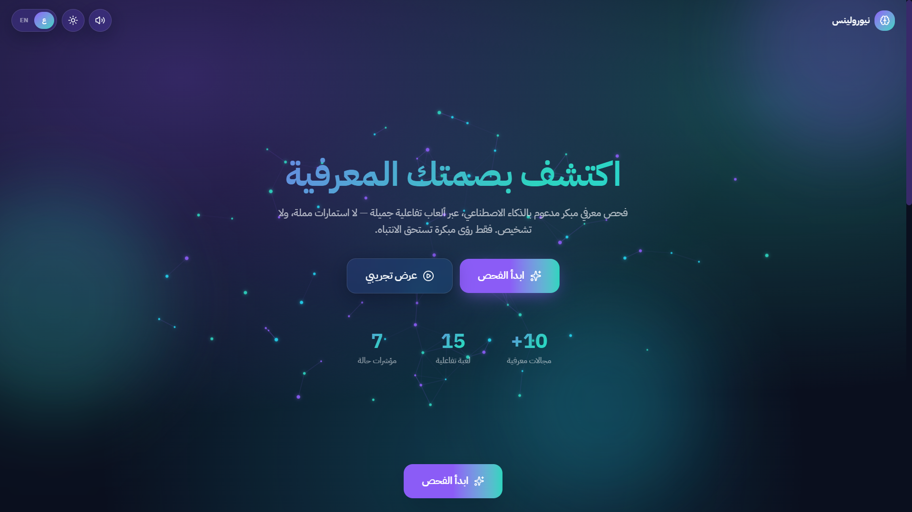
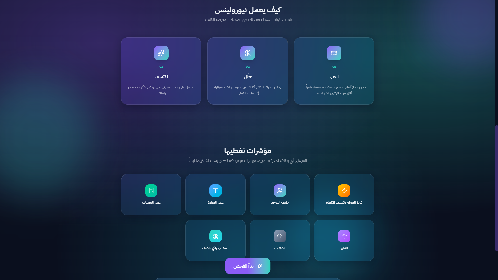
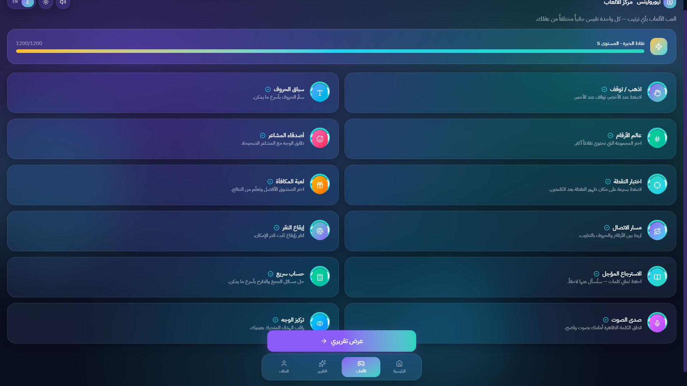
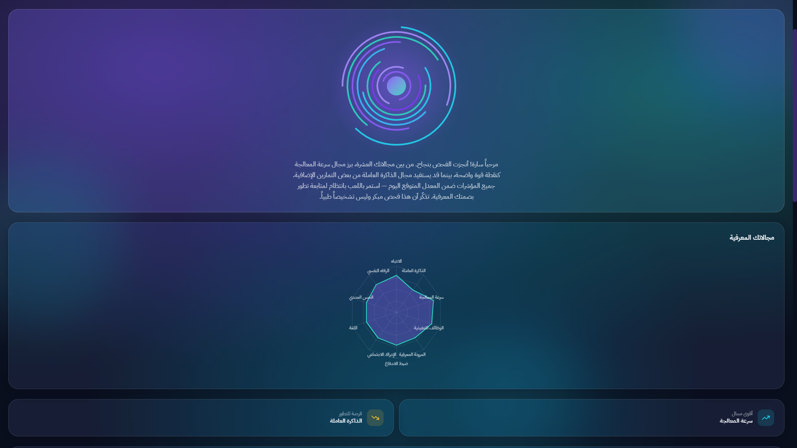
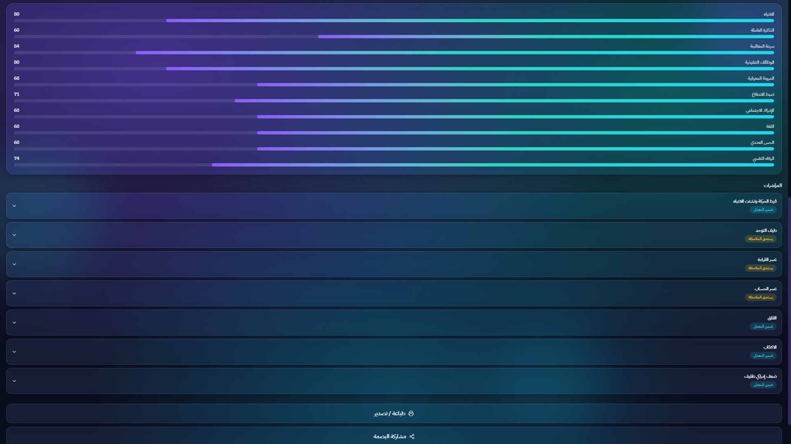

# NeuroLens

### Discover your cognitive fingerprint through play

NeuroLens explores **game-based early awareness of cognitive, learning, and emotional difficulties**. Designed for child and adult profiles, this bilingual React and TypeScript prototype turns interactive activities into a visual **Cognitive Fingerprint**, domain scores, and a plain-language report in Arabic or English.

The current version includes **15 activities**, organized into child and adult game menus with shared activities, **10 domain scores**, and **7 experimental condition-related indicators**. It is a software demonstration, not a clinically validated screening or diagnostic tool.



## The Idea

Make cognitive exploration more approachable through play. Instead of presenting results as isolated numbers, NeuroLens combines short activities with a visual fingerprint and an accessible narrative. The experience is designed around a simple flow: **Play → Explore → Understand**. Its technical focus is interactive UX, modular scoring, bilingual accessibility, and optional AI-assisted report writing.

## What Does It Explore?

The prototype aims to make potential difficulties in attention, impulse control, memory, language, numeracy, social interaction, and emotional wellbeing easier to explore through play. Its report includes experimental indicators labelled for:

- **Attention-deficit/hyperactivity disorder (ADHD)**
- **Autism spectrum disorder (ASD)**
- **Dyslexia** — reading-related difficulties
- **Dyscalculia** — number and arithmetic-related difficulties
- **Anxiety**
- **Depression**
- **Mild cognitive impairment (MCI)**

These labels describe the prototype's intended areas of exploration. Its game scores and fixed rules have not been clinically validated to detect or rule out these conditions. The report supports self-awareness rather than diagnosis.

## Development Highlights

- Built a routed React application with reusable components for navigation, game instructions, consent screens, progress indicators, and reports.
- Implemented Arabic/English localization, right-to-left and left-to-right layouts, dark/light themes, and sound controls.
- Developed interactive activities that capture metrics such as response time, accuracy, memory span, and tapping variability.
- Separated scoring and normalization functions from the interface in `src/engine/`.
- Created an animated circular Cognitive Fingerprint, a radar chart, and domain score bars.
- Integrated optional streaming Claude report narratives with a local bilingual fallback that works without an API key.
- Added consent-based experimental microphone and webcam activities using browser APIs.
- Persisted profiles, results, and session history locally with Zustand and browser localStorage.
- Included a sample-data demo mode, browser printing, and a short text-sharing option.

## Application Flow

1. Choose Arabic or English and create a local profile for a child or adult.
2. Select activities from the game hub and complete the interactive rounds.
3. Generate a report showing the fingerprint, domain scores, indicators, and narrative.
4. Revisit saved sessions or reset locally stored data through Settings.

The landing page also offers a demo report using sample data without replacing the saved profile or session history.

## Activities

| Activity | Interaction |
| --- | --- |
| Star Catcher | Respond to targets while avoiding distractors |
| Emotion Friends | Match faces with emotion labels |
| Letter Race | Identify displayed letters |
| Number World | Compare quantities |
| Treasure Memory | Repeat a visual sequence |
| Color Switch | Respond as sorting rules change |
| Go / No-Go | Respond to go signals and withhold other responses |
| Dot Probe | Respond to a target following word cues |
| Reward Sensitivity | Make choices and receive reward feedback |
| Trail Making | Connect an alternating sequence |
| Finger Tapping | Tap repeatedly and track timing variability |
| Delayed Recall | Recall words after a delay |
| Quick Math | Answer addition and subtraction questions |
| Voice Echo | Experimental audio-level and rhythm sampling |
| Face Focus | Experimental camera-frame brightness sampling |

## Screenshots

<details>
<summary>How it works and indicator overview</summary>



</details>

<details>
<summary>Interactive game hub</summary>



</details>

<details>
<summary>Cognitive Fingerprint and radar chart</summary>



</details>

<details>
<summary>Domain scores and report indicators</summary>



</details>

## Tech Stack

| Technology | Use |
| --- | --- |
| React 19 and TypeScript | Component-based interface and typed application logic |
| Vite | Development server and production build |
| Tailwind CSS v4 | Styling and responsive layouts |
| Framer Motion | Interface transitions and animations |
| React Router | Page navigation |
| Zustand | Application state and localStorage persistence |
| Recharts | Domain radar chart |
| Canvas and SVG | Particle animation and fingerprint visualization |
| Web Audio and MediaDevices APIs | Sound effects and optional sensor activities |
| Anthropic SDK | Optional Claude narrative generation |
| Lucide React and canvas-confetti | Icons and completion effects |

## Run Locally

Use Node.js **22.12+** or a compatible newer release. The project was built with Node.js 24 during repository preparation.

```bash
git clone https://github.com/Shatha-algobaishi/neurolens.git
cd neurolens
npm ci
npm run dev
```

Open the local URL printed by Vite. No account, database, or API key is required for the default local narrative mode. Optional camera and microphone features require browser permission and a secure context such as localhost or HTTPS.

```bash
npm run build    # TypeScript checks and production build
npm run preview  # Preview the production build
npm run lint     # Oxlint checks
```

When hosting on a static platform, configure an SPA fallback to `index.html` for React Router routes.

## Scoring and Prototype Limitations

Raw activity metrics are normalized to 0–100 using hardcoded age-band anchors, then combined into ten domains. The engine also maps scores to seven condition-related labels using fixed thresholds. These anchors and thresholds are implementation choices, not validated population norms or clinical cutoffs. Missing domain data can receive a neutral fallback score of 68, so a displayed score does not necessarily represent a completed activity.

The wellbeing questions are shortened, adapted four-item sets labelled `gad7mini` and `phq9mini` in the code; they are not the full validated questionnaires. Webcam sampling uses frame brightness changes rather than face or eye tracking. Audio sampling uses signal level and rhythm rather than speech recognition or pronunciation analysis. Results should not be used to infer a medical condition or make care decisions.

## Data and Optional AI Integration

Profiles and session history are stored in this browser's localStorage; the app has no backend or account system. Camera frames and microphone samples are processed locally by the implemented sensor helpers, without recording files or uploading the media.

The optional Claude integration sends the profile name, domain scores, and indicator labels to Anthropic to generate report text. It is separate from the rule-based score calculation. With no key configured, or when the request fails, the application uses its local narrative generator.

**Keep `VITE_ANTHROPIC_API_KEY` unset for the default public demo.** The supplied integration runs in the browser and would expose a configured Vite key to the client. A deployed AI-enabled version requires server-side credential handling and an appropriate user-consent flow; these are not implemented in this repository. `.env.example` contains an empty placeholder only.

## Project Structure

```text
src/
  components/  Reusable UI, game, layout, and report components
  engine/      Types, metric normalization, and scoring rules
  lib/         Localization, state, themes, audio, sensor helpers, and AI integration
  pages/       Application pages and 15 activity implementations
docs/
  screenshots/ Project interface screenshots
public/        Static icons
```
